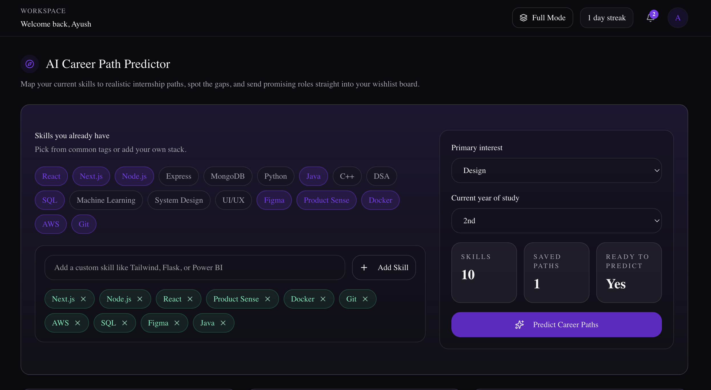
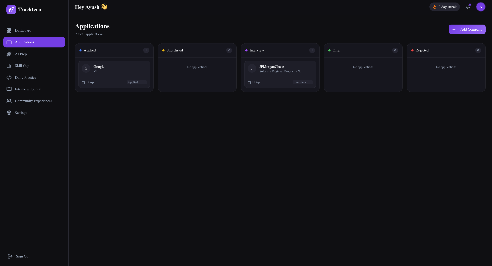
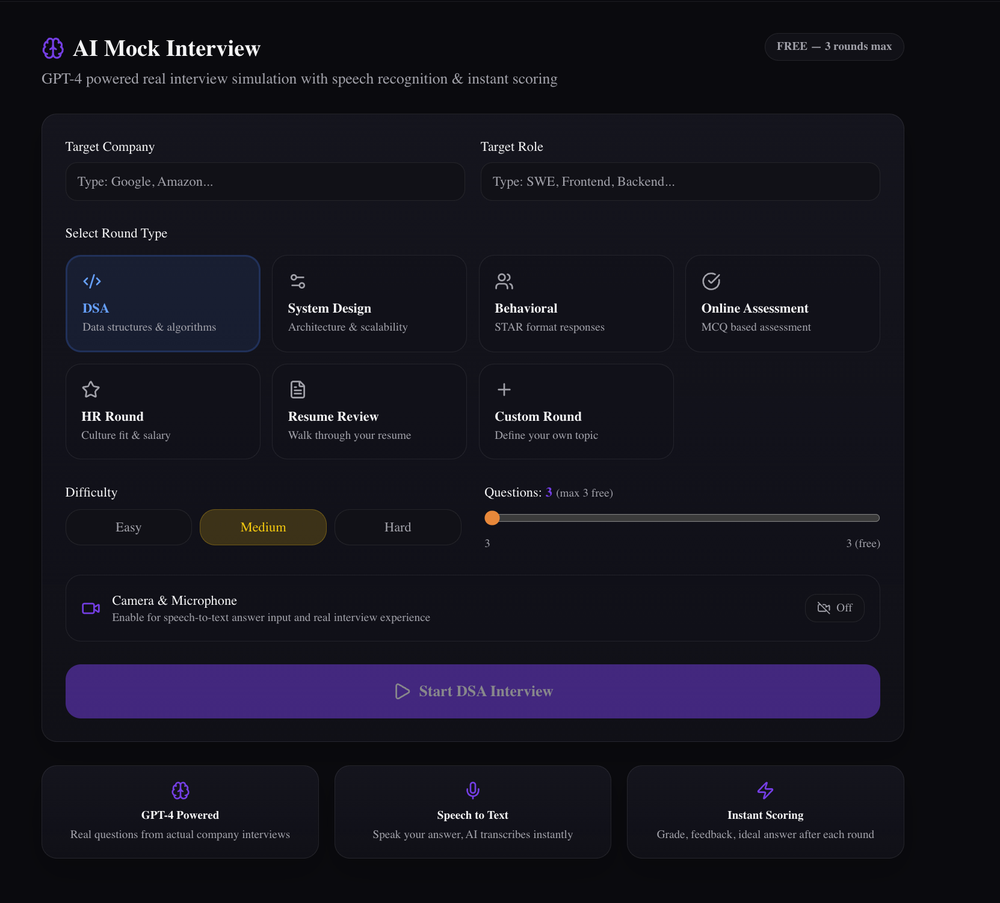
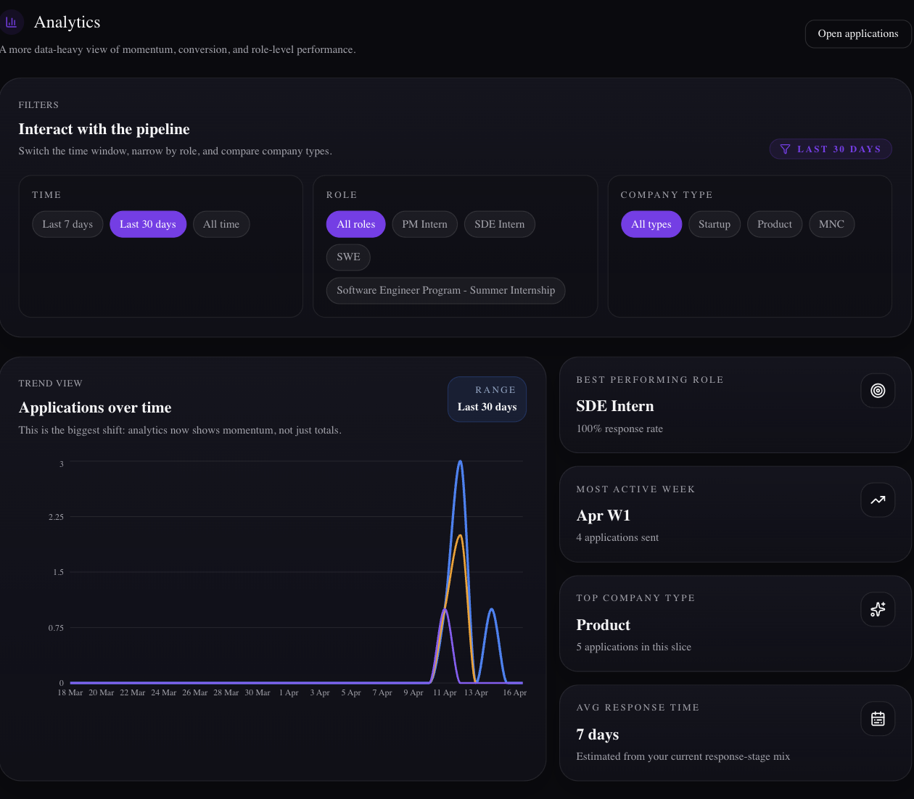
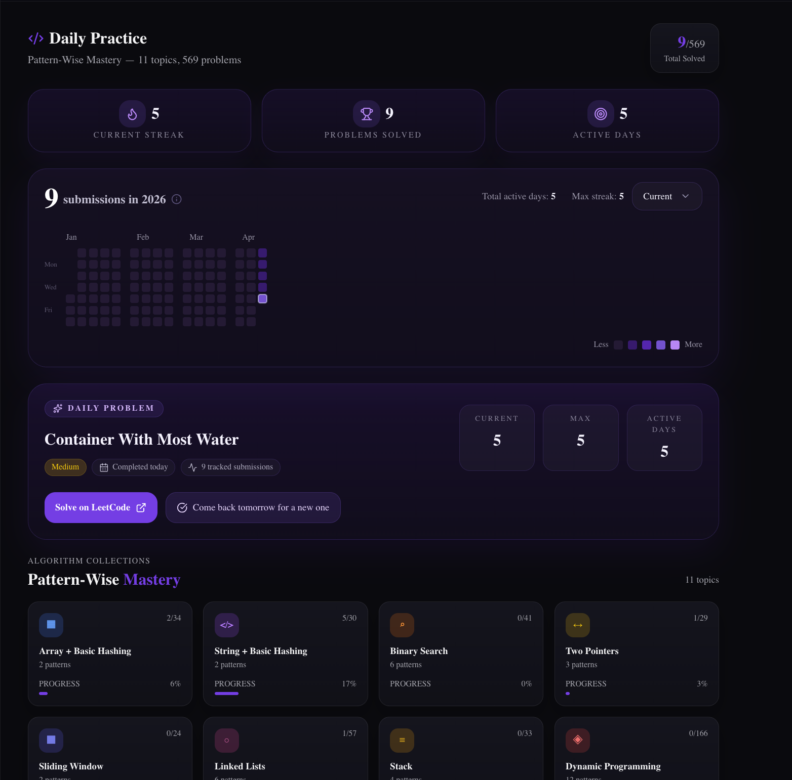
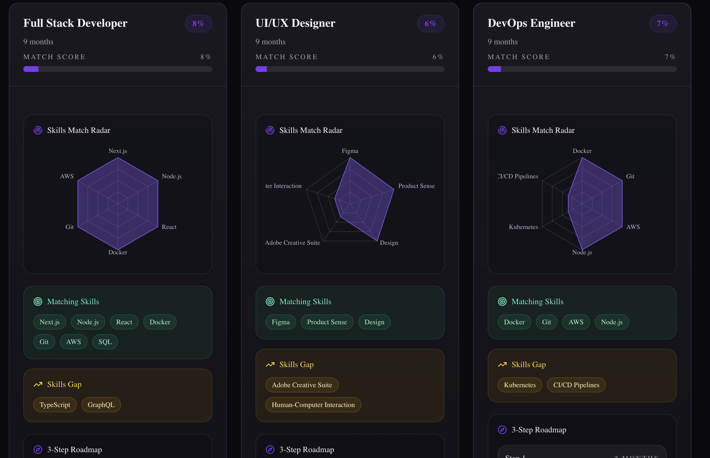
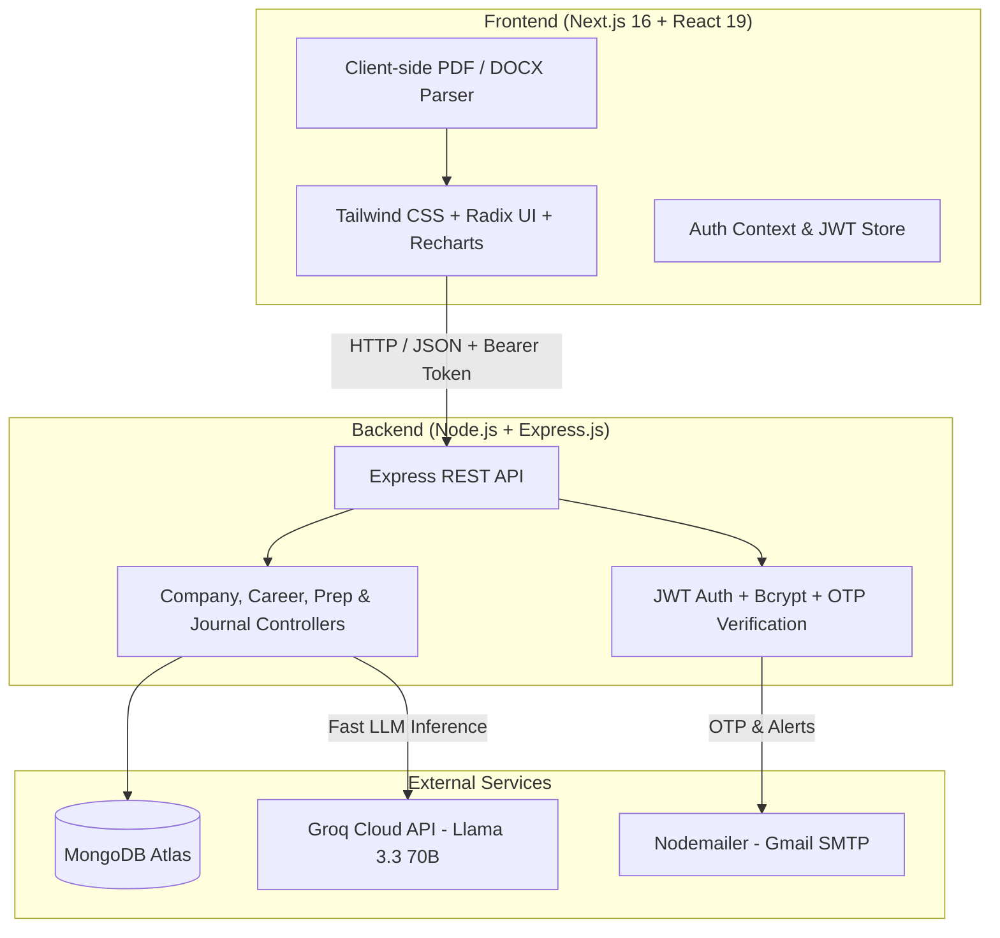

# Tracktern 🚀

<div align="center">

  

  <h3>AI-Powered Internship Tracker & Career Acceleration Platform</h3>

  <p>
    <em>From applied to offered — track every application, predict career paths, analyze resumes with ATS intelligence, and prepare for interviews with AI.</em>
  </p>

  <p>
    <a href="https://github.com/ayushoncode/Tracktern/stargazers"></a>
    <a href="https://github.com/ayushoncode/Tracktern/network/members"></a>
    <a href="https://github.com/ayushoncode/Tracktern/blob/main/LICENSE"></a>
    <a href="https://nextjs.org"></a>
    <a href="https://react.dev"></a>
    <a href="https://nodejs.org"></a>
    <a href="https://mongodb.com"></a>
    <a href="https://groq.com"></a>
  </p>

  <p>
    <a href="#-key-features">Features</a> •
    <a href="#-system-architecture">Architecture</a> •
    <a href="#-tech-stack">Tech Stack</a> •
    <a href="#-screenshots">Screenshots</a> •
    <a href="#-getting-started">Getting Started</a> •
    <a href="#-api-endpoints">API Reference</a> •
    <a href="#-roadmap">Roadmap</a>
  </p>
</div>

---

## 🎯 The Problem

Engineering and CS students apply to **30–60+ companies** every internship and placement season. Most manage this crucial career milestone across messy Excel sheets, bookmarked job links, notes apps, and WhatsApp forwards:

* ❓ *Which companies replied vs. ghosted?*
* ⏳ *Who needs a follow-up email after 7 days?*
* 📉 *Why isn't my resume clearing the ATS filters for specific roles?*
* 🧠 *What exact interview questions will a company ask tomorrow?*
* 🎯 *Which skills am I missing for the roles I'm applying to?*

**Tracktern** brings the entire student job-hunting lifecycle into **one unified command center**: from smart Kanban application tracking to Groq-powered AI interview prep, ATS resume analysis, career roadmap prediction, and automated follow-ups.

---

## ✨ Key Features

### 📋 1. Kanban & Application Management
* **Interactive Kanban Board**: Move applications across `Wishlist`, `Applied`, `Shortlisted`, `Interview`, `Offer`, and `Rejected`.
* **Deep Metadata**: Track company types (Startup, Product, MNC), deadlines, direct job URLs, referral contacts, and interview notes.
* **Instant Filtering & Search**: Filter by status, company type, deadline urgency, or search terms.

### 🧭 2. AI Career Path Predictor
* **Smart Role Matching**: Input your current tech stack, graduation year, and interests.
* **Role Match Score**: AI scores your fit across 20+ software engineering & data roles.
* **Gap Breakdown & Roadmap**: Highlights matching skills, missing gaps, and a step-by-step upskilling roadmap.
* **Direct Job Shortcuts**: One-click targeted search links on **LinkedIn**, **Naukri**, **Internshala**, and **Indeed**.

### 🤖 3. AI Mock Interview & Prep Coach
* **Company & Role-Specific Prep**: Generates top 10 targeted technical & behavioral interview questions.
* **3-Day Actionable Prep Plan**: Day-by-day study roadmap tailored to the target role's tech stack.
* **Interactive Mock Simulator**: Answer interview questions with instant AI evaluation, scoring rubrics, and detailed feedback.
* **Powered by Groq Cloud**: Sub-second LLM inference via `llama-3.3-70b-versatile`.

### 📄 4. ATS Resume Analyzer
* **Client-Side Parsing**: Safely parses `.pdf` and `.docx` resumes using `pdfjs-dist` and `mammoth`.
* **ATS Compatibility Score**: Scored out of 100 with actionable feedback on layout, keywords, impact verbs, and quantified metrics.
* **Role-Targeted Match**: Compares your resume against target job requirements to reveal missing keywords before applying.

### 📊 5. Conversion Funnel & Analytics
* **Funnel Visualization**: Track drop-offs from *Applied → Shortlisted → Interview → Offer*.
* **Company Type Distribution**: Analyze success rates across Startups vs. Product companies vs. MNCs.
* **Key Metrics**: Application velocity, interview conversion rate, average response time, and active pipeline volume.

### 🎯 6. Skill Gap Analyzer & DSA Practice
* **Missing Skills Matrix**: Aggregates all your applied roles and reveals top missing skills prioritized by demand.
* **Consistency Tracker**: Streak counter and daily activity heatmap to maintain momentum.
* **Problem Practice Tracker**: Track DSA problem sets and interview revisions.

### ✉️ 7. Smart Follow-Up & Email Generator
* **Ghosting Tracker**: Automatically flags applications waiting longer than 7 days without updates.
* **AI Follow-Up Drafter**: Generates personalized emails in multiple tones (*Professional*, *Enthusiastic*, *Inquiring*) ready for one-click copy.
* **Nodemailer Integration**: Built-in verification and notification support.

### 📅 8. Interview Calendar & Journal
* **Visual Calendar**: Never miss an upcoming OA (Online Assessment), technical interview, or deadline.
* **Interview Journal**: Log questions asked, difficulty ratings, and interviewer feedback.
* **Community Question Bank**: Explore anonymized peer interview experiences.

---

## 📸 Screenshots

| AI Career Path Predictor | Application Kanban Board |
| :---: | :---: |
|  |  |

| AI Mock Interview | Analytics & Pipeline Health |
| :---: | :---: |
|  |  |

| Daily Practice & Consistency | Career Match Results |
| :---: | :---: |
|  |  |

---

## 🏗️ System Architecture



---

## 🛠️ Tech Stack

### Frontend
* **Framework**: [Next.js 16](https://nextjs.org/) (App Router, Turbopack)
* **Library**: [React 19](https://react.dev/) + [TypeScript](https://www.typescriptlang.org/)
* **Styling**: [Tailwind CSS v4](https://tailwindcss.com/)
* **UI Components**: [Radix UI](https://www.radix-ui.com/) (shadcn/ui primitives), [Lucide React](https://lucide.dev/)
* **Charts & Data**: [Recharts](https://recharts.org/)
* **Document Parsing**: `pdfjs-dist` (PDF parsing) & `mammoth` (DOCX parsing)
* **Feedback & Animations**: [Sonner](https://sonner.emilkowal.ski/), `vaul`, `tw-animate-css`

### Backend
* **Runtime**: [Node.js](https://nodejs.org/)
* **Framework**: [Express.js 5](https://expressjs.com/)
* **Database**: [MongoDB](https://www.mongodb.com/) via [Mongoose 9](https://mongoosejs.com/)
* **Security & Auth**: JSON Web Tokens (`jsonwebtoken`), `bcryptjs`, CORS
* **Mailing**: [Nodemailer](https://nodemailer.com/)

### AI & Cloud
* **LLM Engine**: [Groq Cloud](https://groq.com/) running `llama-3.3-70b-versatile`
* **Backend Hosting**: [Render](https://render.com/) (`https://tracktern-27b8.onrender.com`)
* **Frontend Hosting**: [Vercel](https://vercel.com/)

---

## 📂 Project Structure

```text
Tracktern/
├── client/                     # Next.js 16 Frontend
│   ├── app/
│   │   ├── (dashboard)/        # Authenticated App Routes
│   │   │   ├── ai-prep/        # Role & company interview prep
│   │   │   ├── analytics/      # Funnel & pipeline analytics
│   │   │   ├── applications/   # Kanban board & application list
│   │   │   ├── calendar/       # Interview & deadline calendar
│   │   │   ├── career-path/    # AI career predictor & job links
│   │   │   ├── community/      # Community interview experiences
│   │   │   ├── dashboard/      # Primary stats & overview
│   │   │   ├── follow-up/      # Smart follow-up email drafts
│   │   │   ├── journal/        # Personal interview journal
│   │   │   ├── mock-interview/ # AI mock interview simulator
│   │   │   ├── practice/       # Daily DSA & consistency tracker
│   │   │   ├── resume-analyzer/# ATS resume scoring & keyword check
│   │   │   ├── settings/       # Account & profile management
│   │   │   └── skill-gap/      # Skill matrix & gap analytics
│   │   ├── auth/               # Sign in, Sign up, OTP verification
│   │   ├── layout.tsx          # Root layout & providers
│   │   └── page.tsx            # Marketing landing page
│   ├── components/             # Reusable UI & layout components
│   ├── hooks/                  # Custom React hooks
│   ├── lib/                    # API client, utilities, and helpers
│   ├── public/                 # Static assets & screenshots
│   └── package.json
│
├── server/                     # Node.js + Express Backend
│   ├── models/                 # Mongoose Data Models
│   │   ├── CareerProfile.js    # Career paths & skill profiles
│   │   ├── Company.js          # Tracked job applications
│   │   ├── Journal.js          # Interview question logs
│   │   └── User.js             # User accounts, streaks, OTPs
│   ├── routes/                 # Express API Endpoints
│   │   ├── ai.js               # Prep plans & follow-up generator
│   │   ├── auth.js             # Register, login, OTP, passwords
│   │   ├── career.js           # Career predictions & roadmaps
│   │   ├── community.js        # Public interview logs
│   │   ├── companies.js        # Application CRUD & statuses
│   │   ├── journal.js          # Journal CRUD
│   │   └── mock-interview.js   # AI mock interview engine
│   ├── index.js                # Server entry point
│   └── package.json
│
└── README.md
```

---

## 🚀 Getting Started

Follow these instructions to set up Tracktern locally on your machine.

### Prerequisites

Ensure you have the following installed:
* [Node.js](https://nodejs.org/) (v18.x or v20.x recommended)
* [npm](https://www.npmjs.com/) or [pnpm](https://pnpm.io/)
* [MongoDB](https://www.mongodb.com/) (Local instance or free [MongoDB Atlas](https://www.mongodb.com/atlas) cluster)
* [Groq API Key](https://console.groq.com/keys) (Free tier available)

---

### 1. Clone the Repository

```bash
git clone https://github.com/ayushoncode/Tracktern.git
cd Tracktern
```

---

### 2. Backend Setup (`server`)

1. Navigate to the server folder:
   ```bash
   cd server
   ```

2. Install dependencies:
   ```bash
   npm install
   ```

3. Create your `.env` file from the example template:
   ```bash
   cp .env.example .env
   ```

4. Populate the `.env` variables:
   ```env
   PORT=5002
   MONGODB_URI=mongodb+srv://<username>:<password>@cluster.mongodb.net/tracktern?retryWrites=true&w=majority
   JWT_SECRET=your_super_secret_jwt_key_here
   EMAIL=your_email@gmail.com
   EMAIL_PASS=your_gmail_app_password
   GROQ_API_KEY=gsk_your_groq_api_key_here
   LOG_OTP=true
   ALLOW_OTP_IN_RESPONSE=false
   ```

   > **Note on Gmail SMTP**: If using Gmail, generate a 16-character **App Password** via *Google Account → Security → 2-Step Verification → App Passwords*.

5. Start the backend server:
   ```bash
   npm start
   ```
   The backend will be running at `http://localhost:5002`. Verify by visiting `http://localhost:5002/api/health`.

---

### 3. Frontend Setup (`client`)

1. Open a new terminal and navigate to the client folder:
   ```bash
   cd client
   ```

2. Install dependencies:
   ```bash
   npm install
   ```

3. Create your `.env.local` file:
   ```bash
   cp .env.example .env.local
   ```

4. Ensure your API URL is configured:
   ```env
   NEXT_PUBLIC_API_URL=http://localhost:5002/api
   ```

5. Start the development server:
   ```bash
   npm run dev
   ```

6. Open [http://localhost:3000](http://localhost:3000) in your browser to experience Tracktern!

---

## 📡 API Endpoints Reference

### Authentication (`/api/auth`)
| Method | Endpoint | Description | Protected |
|---|---|---|:---:|
| `POST` | `/api/auth/register` | Register new user & send OTP | ❌ |
| `POST` | `/api/auth/verify-otp` | Verify email OTP & activate account | ❌ |
| `POST` | `/api/auth/login` | Login user & return JWT token | ❌ |
| `POST` | `/api/auth/forgot-password` | Send password reset OTP | ❌ |
| `POST` | `/api/auth/reset-password` | Reset password using verified OTP | ❌ |
| `GET` | `/api/auth/me` | Fetch authenticated user profile & streak | ✅ |
| `POST` | `/api/auth/change-password` | Update account password | ✅ |

### Companies & Applications (`/api/companies`)
| Method | Endpoint | Description | Protected |
|---|---|---|:---:|
| `GET` | `/api/companies` | List all tracked applications for user | ✅ |
| `POST` | `/api/companies` | Add new application card | ✅ |
| `PUT` | `/api/companies/:id` | Update company details or status | ✅ |
| `DELETE` | `/api/companies/:id` | Delete application card | ✅ |

### AI Prep & Follow-ups (`/api/ai`)
| Method | Endpoint | Description | Protected |
|---|---|---|:---:|
| `POST` | `/api/ai/prep` | Generate top 10 questions & 3-day prep plan | ✅ |
| `POST` | `/api/ai/followup` | Draft tailored follow-up email based on status & tone | ✅ |

### Career & Roadmaps (`/api/career`)
| Method | Endpoint | Description | Protected |
|---|---|---|:---:|
| `POST` | `/api/career/predict` | Predict best-fit roles, skill gaps & roadmaps | ✅ |
| `GET` | `/api/career/profile` | Fetch user's saved career path profile | ✅ |
| `POST` | `/api/career/save-path` | Save target path to user profile | ✅ |

### Mock Interviews (`/api/mock-interview`)
| Method | Endpoint | Description | Protected |
|---|---|---|:---:|
| `POST` | `/api/mock-interview/generate` | Generate mock interview questions for role & company | ✅ |
| `POST` | `/api/mock-interview/evaluate` | Evaluate candidate answer & provide score/feedback | ✅ |

### Journal & Community (`/api/journal` & `/api/community`)
| Method | Endpoint | Description | Protected |
|---|---|---|:---:|
| `GET` | `/api/journal` | List user's logged interview notes | ✅ |
| `POST` | `/api/journal` | Add interview reflection / questions asked | ✅ |
| `GET` | `/api/community` | Get shared interview experiences from community | ❌ |

---

## 🔮 Roadmap

- [x] **Next.js 16 + React 19** migration with full modern design system
- [x] **ATS Resume Analyzer** with client-side PDF/DOCX parsing
- [x] **AI Career Predictor** with direct job portal shortcuts
- [x] **AI Mock Interview Coach** powered by Groq Llama 3.3
- [x] **Interactive Kanban Board** with company categories and notes
- [x] **Smart Follow-up Drafter** with ghosting detection
- [ ] **Automated Gmail Sync**: Auto-detect status updates directly from incoming emails via Gmail OAuth2
- [ ] **Browser Extension**: 1-click application saving directly from LinkedIn, Internshala, and Wellfound
- [ ] **Peer Mock Rooms**: Real-time peer-to-peer mock interview rooms with video & collaborative coding pad
- [ ] **Mobile App**: Cross-platform React Native companion app for on-the-go deadline alerts

---

## 🤝 Contributing

Contributions are what make the open-source community such an amazing place to learn, inspire, and create. Any contributions you make are **greatly appreciated**!

1. **Fork the Project**
2. **Create your Feature Branch** (`git checkout -b feature/AmazingFeature`)
3. **Commit your Changes** (`git commit -m 'Add some AmazingFeature'`)
4. **Push to the Branch** (`git push origin feature/AmazingFeature`)
5. **Open a Pull Request**

---

## 📄 License

Distributed under the **MIT License**. See [`LICENSE`](LICENSE) for more information.

---

## 👨‍💻 Author & Acknowledgements

Created with ❤️ by **[Ayush (@ayushoncode)](https://github.com/ayushoncode)**.

* Built with [Next.js](https://nextjs.org), [Tailwind CSS](https://tailwindcss.com), and [Groq Cloud](https://groq.com).
* Icons provided by [Lucide](https://lucide.dev/).
* Components inspired by [shadcn/ui](https://ui.shadcn.com/).

<div align="center">
  <p>⭐ If you found Tracktern helpful, please consider starring the repository!</p>
</div>
